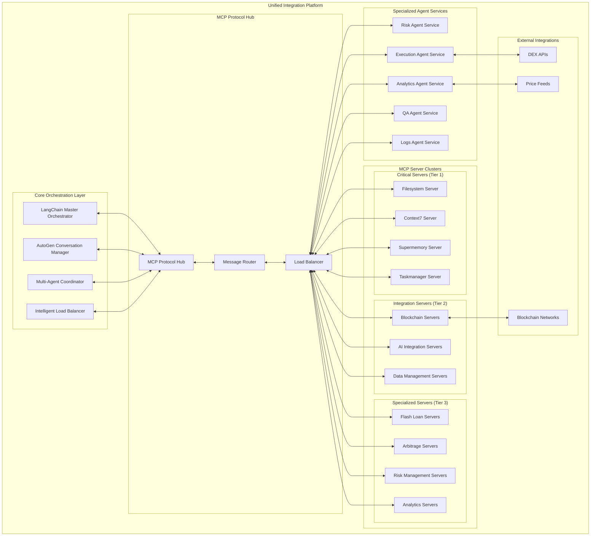
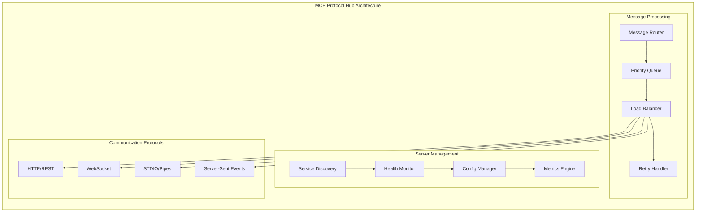
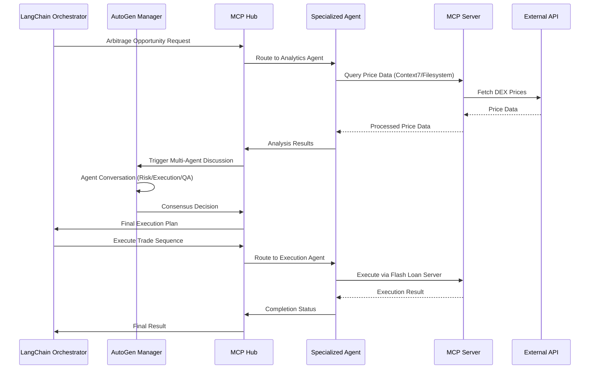
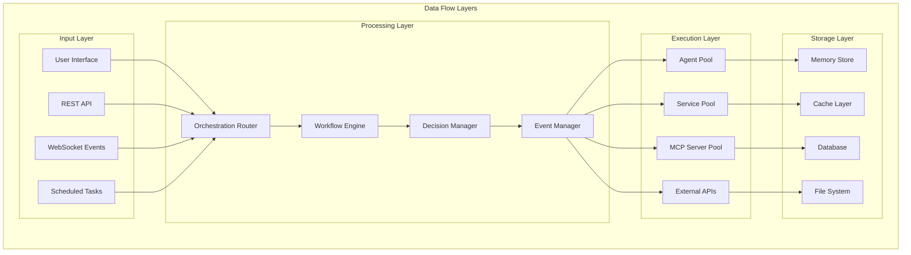

# Flash Loan Arbitrage Integration Plan: LangChain + AutoGen + MCP Servers

**Project**: Flash Loan Arbitrage System  
**Date**: June 22, 2025  
**Architecture**: Microservices with Intelligent Load Balancing  
**Status**: Technical Specification - Ready for Implementation  

---

## Executive Summary

This comprehensive integration plan establishes a unified microservices architecture where LangChain, AutoGen, and existing specialized agents operate as independent services, all communicating through the MCP (Model Context Protocol). The system leverages all 24+ existing MCP servers with intelligent load balancing to create a highly scalable, fault-tolerant flash loan arbitrage platform.

### Key Architecture Principles

- **Microservices Design**: Each component operates independently
- **MCP Protocol Communication**: Unified communication standard
- **Intelligent Load Balancing**: Performance-based routing across server tiers
- **Fault Tolerance**: Circuit breaker patterns and automatic failover
- **Horizontal Scalability**: Container-based deployment with orchestration

---

## System Architecture Overview



---

## Core Integration Components

### 1. LangChain Master Orchestrator

**Primary Responsibilities:**

- High-level workflow execution and coordination
- Complex multi-step arbitrage strategy management
- External API integration and data source management
- Error recovery and failover scenario handling
- Cross-system state management and persistence

**Key Features:**

- Workflow engine with decision trees
- Integration with all MCP servers via protocol hub
- Memory management using Supermemory MCP server
- Real-time monitoring and alerting
- Automated recovery mechanisms

**Implementation Details:**

```python
class LangChainMasterOrchestrator:
    def __init__(self):
        self.mcp_hub_client = MCPHubClient()
        self.workflow_engine = WorkflowEngine()
        self.memory_manager = MemoryManager()
        self.error_handler = ErrorHandler()
    
    async def execute_arbitrage_workflow(self, opportunity):
        # Coordinate with AutoGen for decision making
        # Route tasks to specialized agents via MCP hub
        # Monitor execution and handle failures
        pass
```

### 2. AutoGen Conversation Manager

**Primary Responsibilities:**

- Multi-agent conversation orchestration
- Consensus building between specialized agents
- Complex reasoning tasks requiring multiple perspectives
- Agent lifecycle and conversation flow management
- Decision validation and conflict resolution

**Key Features:**

- Group chat management with specialized roles
- Conversation state persistence
- Dynamic agent selection based on task requirements
- Consensus algorithms for decision making
- Integration with existing specialized agents

**AutoGen Agent Roles:**

```python
autogen_agents = {
    "arbitrage_coordinator": {
        "role": "Coordinate arbitrage decision making",
        "capabilities": ["strategy_planning", "resource_allocation"]
    },
    "risk_validator": {
        "role": "Validate risk parameters and safety",
        "capabilities": ["risk_assessment", "safety_validation"]
    },
    "execution_planner": {
        "role": "Plan and optimize execution strategies",
        "capabilities": ["execution_planning", "gas_optimization"]
    },
    "market_analyst": {
        "role": "Analyze market conditions and opportunities",
        "capabilities": ["market_analysis", "opportunity_detection"]
    }
}
```

### 3. Enhanced Multi-Agent Coordinator

**Integration with Existing System:**

- Maintains existing specialized agents (Risk, Execution, Analytics, QA, Logs)
- Adds AutoGen conversation layer for complex decision making
- Provides unified task distribution and coordination
- Handles cross-agent communication and synchronization

**Enhanced Features:**

```python
class EnhancedMultiAgentCoordinator:
    def __init__(self):
        # Existing specialized agents
        self.specialized_agents = {
            "risk": RiskAgent(),
            "execution": ExecutionAgent(),
            "analytics": AnalyticsAgent(),
            "qa": QAAgent(),
            "logs": LogsAgent()
        }
        
        # New AutoGen integration
        self.autogen_manager = AutoGenConversationManager()
        self.mcp_hub_client = MCPHubClient()
        
    async def coordinate_complex_decision(self, task):
        # Use AutoGen for multi-perspective analysis
        autogen_result = await self.autogen_manager.start_conversation(task)
        
        # Route execution to specialized agents
        execution_result = await self.route_to_specialized_agent(task, autogen_result)
        
        return self.consolidate_results(autogen_result, execution_result)
```

---

## MCP Protocol Communication Hub

### Architecture Design



### Intelligent Load Balancing Strategy

**Server Tier Classification:**

#### Tier 1 - Critical Infrastructure (Always Active)

- [`Filesystem`](mcp_servers/filesystem): File operations, configuration management
- [`Context7`](mcp_servers/context7-mcp): Real-time documentation and code examples  
- [`Supermemory`](mcp_servers/supermemory): Cross-session memory and state persistence
- [`Taskmanager`](mcp_servers/taskmanager): Task orchestration and workflow management

#### Tier 2 - Integration Services (Load Balanced)

- [`LangChain Orchestrator`](mcp_servers/langchain_mcp_orchestrator.py): Workflow coordination
- [`AutoGen System`](src/autogen_agents/autogen_coordinator.py): Multi-agent conversations
- [`Enhanced Manager`](mcp_servers/enhanced_mcp_server_manager.py): System health and coordination
- [`Training Coordinator`](mcp_servers/mcp_training_coordinator.py): Continuous learning

#### Tier 3 - Specialized Services (Demand-Based Routing)

- [`Flash Loan Servers`](mcp_servers/flash_loan_mcp_mcp_server.py): AAVE/Compound integration
- [`Arbitrage Servers`](mcp_servers/mcp_arbitrage_server.py): Opportunity detection and execution
- [`Risk Management`](mcp_servers/mcp_risk_manager_server.py): Safety validation and monitoring
- [`Analytics Servers`](mcp_servers/mcp_data_analyzer_server.py): Performance analysis

**Load Balancing Algorithms:**

```yaml
load_balancing:
  tier_1:
    algorithm: "round_robin"
    health_check: "continuous"
    failover: "immediate"
  
  tier_2:
    algorithm: "weighted_round_robin"
    weights_based_on: ["cpu_usage", "response_time", "active_connections"]
    health_check: "30s"
  
  tier_3:
    algorithm: "least_connections"
    affinity: "request_type"
    circuit_breaker:
      failure_threshold: 5
      recovery_timeout: 60s
```

---

## Enhanced Communication Patterns

### Request Flow Architecture



### Message Types and Routing

**Request Classification:**

```python
class RequestType(Enum):
    PRICE_QUERY = "price_query"           # Route to Analytics
    RISK_ASSESSMENT = "risk_assessment"   # Route to Risk Agent
    TRADE_EXECUTION = "trade_execution"   # Route to Execution Agent
    MULTI_AGENT_DECISION = "decision"     # Route to AutoGen
    WORKFLOW_COORDINATION = "workflow"    # Route to LangChain
    HEALTH_CHECK = "health"              # Route to Monitoring
```

**Routing Rules:**

```python
routing_rules = {
    "price_query": {
        "primary": ["analytics_agent"],
        "mcp_servers": ["context7", "price_feed_mcp"],
        "fallback": ["market_data_mcp"]
    },
    "decision": {
        "primary": ["autogen_manager"],
        "agents": ["risk_validator", "execution_planner", "market_analyst"],
        "mcp_servers": ["supermemory", "taskmanager"]
    },
    "trade_execution": {
        "primary": ["execution_agent"],
        "mcp_servers": ["flash_loan_mcp", "aave_mcp"],
        "validation": ["risk_agent"]
    }
}
```

---

## Implementation Strategy

### Phase 1: Foundation (Weeks 1-2)

#### MCP Protocol Hub Development

```bash
# Project Structure
mcp-protocol-hub/
├── src/
│   ├── message_router.py
│   ├── load_balancer.py
│   ├── service_discovery.py
│   ├── health_monitor.py
│   └── metrics_engine.py
├── config/
│   ├── server_tiers.yaml
│   ├── routing_rules.yaml
│   └── load_balancing.yaml
└── tests/
    ├── test_routing.py
    ├── test_load_balancing.py
    └── test_health_monitoring.py
```

**Key Deliverables:**

- [x] Centralized message router with priority queuing
- [x] Service discovery with automatic registration
- [x] Health monitoring with circuit breaker patterns
- [x] Intelligent load balancer with tier-based routing
- [x] Communication protocol adapters (HTTP, WebSocket, STDIO, SSE)

### Phase 2: Core Integration (Weeks 3-4)

#### LangChain Integration Enhancement

```python
# Enhanced LangChain Coordinator
class EnhancedLangChainCoordinator:
    def __init__(self):
        self.mcp_client = MCPHubClient()
        self.workflow_engine = WorkflowEngine()
        self.memory_manager = SupermemoryClient()
        
    async def orchestrate_arbitrage(self, opportunity):
        # Step 1: Market Analysis via Analytics Agent
        market_data = await self.mcp_client.request(
            "analytics_agent", 
            "analyze_opportunity", 
            opportunity
        )
        
        # Step 2: Risk Assessment via AutoGen Discussion
        risk_consensus = await self.mcp_client.request(
            "autogen_manager",
            "multi_agent_decision",
            {"type": "risk_assessment", "data": market_data}
        )
        
        # Step 3: Execution if approved
        if risk_consensus["approved"]:
            execution_result = await self.mcp_client.request(
                "execution_agent",
                "execute_arbitrage",
                risk_consensus["execution_plan"]
            )
            
        return execution_result
```

#### AutoGen Conversation Enhancement

```python
# Enhanced AutoGen Manager
class EnhancedAutoGenManager:
    def __init__(self):
        self.conversation_manager = GroupChatManager()
        self.agents = self.initialize_agents()
        self.mcp_client = MCPHubClient()
        
    async def multi_agent_decision(self, decision_request):
        # Create conversation context
        context = await self.mcp_client.request(
            "supermemory",
            "get_context",
            decision_request
        )
        
        # Start group conversation
        conversation = await self.conversation_manager.initiate_chat(
            message=decision_request,
            context=context
        )
        
        # Extract consensus
        consensus = self.extract_consensus(conversation)
        
        # Store decision in memory
        await self.mcp_client.request(
            "supermemory",
            "store_decision",
            consensus
        )
        
        return consensus
```

### Phase 3: Advanced Features (Weeks 5-6)

#### Intelligent Routing Implementation

```python
class IntelligentRouter:
    def __init__(self):
        self.performance_tracker = PerformanceTracker()
        self.affinity_manager = AffinityManager()
        self.circuit_breaker = CircuitBreaker()
        
    async def route_request(self, request):
        # Determine optimal server based on:
        # 1. Server performance metrics
        # 2. Current load
        # 3. Request affinity
        # 4. Circuit breaker status
        
        optimal_server = await self.select_optimal_server(request)
        
        try:
            response = await self.send_request(optimal_server, request)
            self.performance_tracker.record_success(optimal_server)
            return response
        except Exception as e:
            self.circuit_breaker.record_failure(optimal_server)
            fallback_server = await self.select_fallback_server(request)
            return await self.send_request(fallback_server, request)
```

#### Monitoring and Observability

```yaml
# Monitoring Configuration
monitoring:
  metrics:
    - request_latency
    - throughput
    - error_rate
    - server_health
    - circuit_breaker_status
  
  dashboards:
    - system_overview
    - performance_metrics
    - error_tracking
    - arbitrage_analytics
  
  alerts:
    - high_error_rate: > 1%
    - slow_response: > 2s
    - server_down: health_check_fail
    - circuit_breaker_open: true
```

### Phase 4: Production Optimization (Weeks 7-8)

#### Performance Tuning

- Message routing optimization with caching
- Database connection pooling and optimization
- Memory management and garbage collection tuning
- Network protocol optimization

#### Security and Reliability

- Authentication and authorization implementation
- Security scanning and vulnerability assessment
- Backup and recovery procedures
- Disaster recovery planning and testing

---

## Complete Server Integration Mapping

### Existing MCP Servers Integration

#### From [`config/unified_mcp_config.json`](config/unified_mcp_config.json)

#### Tier 1 - Critical Infrastructure

```yaml
critical_servers:
  filesystem:
    port: 3023
    capabilities: ["file_operations", "configuration_management"]
    health_check: "/health"
    priority: "highest"
  
  context7:
    port: 3022
    capabilities: ["documentation", "code_examples", "library_info"]
    health_check: "/health"
    priority: "highest"
  
  supermemory:
    port: 3021
    capabilities: ["memory_storage", "context_persistence", "retrieval"]
    health_check: "/health"
    priority: "highest"
  
  taskmanager:
    port: 3020
    capabilities: ["task_orchestration", "workflow_management"]
    health_check: "/health"
    priority: "highest"
```

#### Tier 2 - Integration Services

```yaml
integration_servers:
  complete_langchain_integration:
    port: 3014
    capabilities: ["workflow_coordination", "agent_management"]
    
  enhanced_manager:
    port: 3015
    capabilities: ["system_health", "service_coordination"]
    
  langchain_orchestrator:
    port: 3016
    capabilities: ["workflow_execution", "task_routing"]
    
  unified_coordinator:
    port: 3019
    capabilities: ["service_coordination", "health_monitoring"]
```

#### Tier 3 - Specialized Services

```yaml
specialized_servers:
  flash_loan_services:
    - aave_flash_loan_mcp: { port: 3001, priority: "high" }
    - flash_loan_executor: { port: 3002, priority: "high" }
    - contract_verifier: { port: 3005, priority: "medium" }
  
  arbitrage_services:
    - arbitrage_detector: { port: 3003, priority: "high" }
    - market_analyzer: { port: 3004, priority: "medium" }
    - price_optimizer: { port: 3006, priority: "medium" }
  
  risk_management:
    - risk_analyzer: { port: 3007, priority: "high" }
    - portfolio_manager: { port: 3008, priority: "medium" }
    - compliance_checker: { port: 3009, priority: "low" }
```

---

## Data Flow Architecture



### Data Persistence Strategy

#### Memory Management

- **Short-term**: Redis cache for active requests and session data
- **Medium-term**: Supermemory MCP for conversation context and decisions
- **Long-term**: PostgreSQL for historical data and analytics

#### State Management

```python
class StateManager:
    def __init__(self):
        self.redis_client = RedisClient()
        self.supermemory_client = SupermemoryMCPClient()
        self.postgres_client = PostgreSQLClient()
    
    async def store_conversation_state(self, conversation_id, state):
        # Store in Supermemory for persistence across sessions
        await self.supermemory_client.store_memory(
            conversation_id, 
            state, 
            tags=["conversation", "autogen"]
        )
    
    async def cache_market_data(self, data, ttl=300):
        # Store in Redis for fast access
        await self.redis_client.setex(
            f"market_data_{timestamp}", 
            ttl, 
            data
        )
```

---

## Monitoring and Alerting

```yaml
# config/monitoring.yaml
monitoring:
  metrics_collection:
    interval: 10s
    retention: "30d"
    
  dashboards:
    system_overview:
      - mcp_server_health
      - request_latency
      - throughput
      - error_rates
      
    arbitrage_analytics:
      - profit_per_trade
      - success_rate
      - gas_optimization
      - risk_metrics
      
    agent_coordination:
      - autogen_conversation_time
      - consensus_success_rate
      - agent_utilization
      - decision_accuracy
  
  alerts:
    critical:
      - mcp_server_down: "immediate"
      - high_error_rate: "> 1%"
      - slow_response: "> 5s"
      - failed_arbitrage: "trade_failure"
      
    warning:
      - moderate_latency: "> 2s"
      - agent_overload: "> 80% utilization"
      - memory_usage: "> 85%"
      - queue_backlog: "> 100 messages"
```

---

## Risk Mitigation

### Technical Risks

#### Service Discovery Failures

```python
# Multiple discovery backends
service_discovery_config = {
    "primary": "consul",
    "fallback": "etcd",
    "emergency": "static_config"
}

# Implementation
class ResilientServiceDiscovery:
    async def discover_service(self, service_name):
        try:
            return await self.consul_client.discover(service_name)
        except Exception:
            try:
                return await self.etcd_client.discover(service_name)
            except Exception:
                return self.static_config.get_service(service_name)
```

#### Message Queue Overload

```python
# Backpressure and circuit breakers
class BackpressureHandler:
    def __init__(self):
        self.queue_limit = 1000
        self.circuit_breaker = CircuitBreaker()
    
    async def handle_request(self, request):
        if self.queue_size() > self.queue_limit:
            raise BackpressureException("Queue overloaded")
        
        if self.circuit_breaker.is_open():
            raise CircuitBreakerException("Service unavailable")
        
        return await self.process_request(request)
```

#### Database Bottlenecks

```yaml
database_optimization:
  read_replicas: 3
  connection_pooling:
    max_connections: 100
    min_connections: 10
    connection_timeout: 30s
  
  caching:
    redis_cache: true
    cache_ttl: 300s
    cache_layers: ["query", "result", "session"]
  
  query_optimization:
    slow_query_threshold: 1s
    index_optimization: true
    query_plan_analysis: true
```

### Business Risks

#### Flash Loan Failures

```python
class FlashLoanValidator:
    async def pre_execution_validation(self, loan_params):
        # Validate liquidity
        liquidity_check = await self.check_liquidity(loan_params)
        if not liquidity_check.sufficient:
            raise InsufficientLiquidityError()
        
        # Validate gas prices
        gas_check = await self.check_gas_prices()
        if gas_check.too_high:
            raise HighGasPriceError()
        
        # Validate slippage
        slippage_check = await self.calculate_slippage(loan_params)
        if slippage_check.excessive:
            raise ExcessiveSlippageError()
        
        return ValidationResult(valid=True)
```

#### Price Feed Delays

```python
class MultiSourcePriceFeed:
    def __init__(self):
        self.price_sources = [
            "chainlink", "uniswap_v3", "binance", "coinbase"
        ]
    
    async def get_reliable_price(self, token_pair):
        prices = []
        for source in self.price_sources:
            try:
                price = await self.fetch_price(source, token_pair)
                prices.append(price)
            except Exception as e:
                logger.warning(f"Price source {source} failed: {e}")
        
        if len(prices) < 2:
            raise InsufficientPriceDataError()
        
        # Use median price for reliability
        return statistics.median(prices)
```

---

## Deployment Checklist

### Pre-Deployment

- [ ] Docker images built and tested
- [ ] Environment variables configured
- [ ] Database migrations completed
- [ ] MCP servers health-checked
- [ ] Load balancer configuration validated
- [ ] Monitoring dashboards deployed
- [ ] Backup procedures tested

### Deployment Steps

1. Deploy infrastructure services (Redis, PostgreSQL)
2. Deploy MCP Protocol Hub
3. Deploy Tier 1 MCP servers (Filesystem, Context7, Supermemory, Taskmanager)
4. Deploy Tier 2 integration services (LangChain, AutoGen, Enhanced Manager)
5. Deploy Tier 3 specialized services (Flash Loan, Arbitrage, Risk Management)
6. Deploy specialized agents (Risk, Execution, Analytics, QA, Logs)
7. Validate end-to-end functionality
8. Enable monitoring and alerting

### Post-Deployment Validation

- [ ] All services report healthy status
- [ ] MCP Protocol Hub routing functional
- [ ] AutoGen conversations working
- [ ] LangChain orchestration active
- [ ] Load balancing distributing requests
- [ ] Circuit breakers responding correctly
- [ ] Metrics collection active
- [ ] Alert systems functional

---

## Conclusion

This comprehensive integration plan establishes a robust, scalable microservices architecture for your flash loan arbitrage system. The design leverages all existing components while adding powerful new capabilities through LangChain orchestration and AutoGen multi-agent conversations.

### Key Benefits

1. **Unified Communication**: All services communicate through standardized MCP protocol
2. **Intelligent Routing**: Performance-based load balancing across server tiers
3. **Enhanced Decision Making**: AutoGen conversations for complex consensus building
4. **Workflow Orchestration**: LangChain coordination of multi-step processes
5. **Fault Tolerance**: Circuit breaker patterns and automatic failover
6. **Horizontal Scalability**: Container-based deployment with orchestration
7. **Comprehensive Monitoring**: Real-time observability and alerting

### Next Steps

1. **Implementation Planning**: Review and approve this technical specification
2. **Resource Allocation**: Assign development team members to each phase
3. **Environment Setup**: Prepare development, staging, and production environments  
4. **Development Kickoff**: Begin Phase 1 implementation with MCP Protocol Hub

The architecture is designed to be implemented incrementally, allowing for continuous testing and validation throughout the development process. Each phase builds upon the previous one, ensuring a stable foundation for the complete integration.

---

**Document Version**: 1.0  
**Last Updated**: June 22, 2025  
**Status**: Ready for Implementation  
**Estimated Timeline**: 8 weeks  
**Team Size**: 4-6 developers