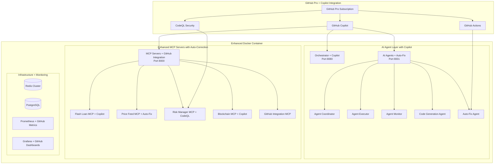

# Multi-MCP Server Container Plan with GitHub Pro Integration

## Overview
This comprehensive plan creates a production-ready Docker container with multiple free MCP servers for high-frequency flash loan arbitrage, enhanced with GitHub Pro + Copilot for automated error fixing and syntax improvement.

## Architecture



## Free MCP Servers to Include

### 1. Core Trading Servers (GitHub Pro Enhanced)
- **mcp_flash_loan_server.py** - Primary flash loan execution with Copilot optimization
- **mcp_price_feed_server.py** - Real-time price aggregation with auto-fix
- **mcp_arbitrage_server.py** - Opportunity detection with AI suggestions
- **mcp_dex_aggregator_server.py** - Multi-DEX integration with code quality checks

### 2. Risk & Monitoring Servers
- **mcp_risk_manager_server.py** - Real-time risk assessment with CodeQL security
- **mcp_monitoring_server.py** - System health monitoring with GitHub metrics
- **mcp_blockchain_server.py** - Multi-chain monitoring with automated fixes
- **mcp_performance_monitor.py** - Latency tracking with Copilot optimization

### 3. GitHub Integration Servers
- **mcp_github_copilot_server.py** - Copilot API integration
- **mcp_github_actions_server.py** - CI/CD automation
- **mcp_code_quality_server.py** - Automated code review
- **mcp_security_scanner_server.py** - Vulnerability scanning
- **mcp_syntax_fixer_server.py** - Real-time syntax correction
- **mcp_test_generator_server.py** - Automated test generation

### 4. Data & Infrastructure Servers
- **mcp_database_server.py** - Transaction logging with auto-optimization
- **mcp_cache_manager_server.py** - Redis management with performance tuning
- **mcp_notification_server.py** - Alert system with GitHub notifications
- **mcp_load_balancer.py** - Request distribution with auto-scaling

### 5. AI Training & Communication Servers
- **mcp_training_orchestrator.py** - Coordinate AI model training
- **mcp_model_inference.py** - Real-time prediction serving
- **mcp_communication_hub.py** - Inter-agent message routing
- **mcp_strategy_generator.py** - AI-generated trading strategies

## GitHub Actions Workflows

### 1. Flash Loan MCP Server Workflow
```yaml
# .github/workflows/flash-loan-mcp.yml
name: Flash Loan MCP Server CI/CD

on:
  push:
    paths:
      - 'mcp_servers/mcp_flash_loan_server.py'
      - 'mcp_servers/flash_loan/**'
  pull_request:
    paths:
      - 'mcp_servers/mcp_flash_loan_server.py'

jobs:
  flash-loan-ci:
    runs-on: ubuntu-latest
    strategy:
      matrix:
        python-version: [3.9, 3.10, 3.11]
        
    steps:
    - uses: actions/checkout@v4
    
    - name: Set up Python ${{ matrix.python-version }}
      uses: actions/setup-python@v4
      with:
        python-version: ${{ matrix.python-version }}
    
    - name: Install Flash Loan Dependencies
      run: |
        pip install web3 eth-brownie pytest pytest-asyncio
        pip install -r requirements-flash-loan.txt
    
    - name: GitHub Copilot Code Review
      uses: github/copilot-cli-action@v1
      with:
        command: 'review'
        files: 'mcp_servers/mcp_flash_loan_server.py'
    
    - name: Auto-Fix Syntax Errors
      run: |
        python scripts/auto_fix_flash_loan_syntax.py
        
    - name: Security Scan for Flash Loan Logic
      uses: github/codeql-action/analyze@v2
      with:
        languages: python
        queries: security-and-quality
        
    - name: Flash Loan Unit Tests
      run: |
        pytest tests/test_flash_loan_mcp.py -v --cov=mcp_servers
        
    - name: Flash Loan Integration Tests
      run: |
        pytest tests/integration/test_flash_loan_integration.py -v
        
    - name: Performance Benchmarks
      run: |
        python benchmarks/flash_loan_performance.py
        
    - name: Deploy Flash Loan MCP
      if: github.ref == 'refs/heads/main'
      run: |
        docker build -t flash-loan-mcp:latest -f containers/mcp-flash-loan/Dockerfile .
        docker-compose up flash-loan-mcp -d
```

### 2. Price Feed MCP Server Workflow
```yaml
# .github/workflows/price-feed-mcp.yml
name: Price Feed MCP Server CI/CD

on:
  push:
    paths:
      - 'mcp_servers/mcp_price_feed_server.py'
      - 'mcp_servers/price_feed/**'
  schedule:
    - cron: '0 */4 * * *'  # Run every 4 hours for price data updates

jobs:
  price-feed-ci:
    runs-on: ubuntu-latest
    
    steps:
    - uses: actions/checkout@v4
    
    - name: Setup Python with Price Feed Libraries
      uses: actions/setup-python@v4
      with:
        python-version: '3.11'
    
    - name: Install Price Feed Dependencies
      run: |
        pip install ccxt requests aiohttp redis
        pip install -r requirements-price-feed.txt
    
    - name: Copilot Price Feed Optimization
      uses: github/copilot-cli-action@v1
      with:
        command: 'optimize'
        files: 'mcp_servers/mcp_price_feed_server.py'
        context: 'high-frequency trading price feeds'
    
    - name: Price Feed Data Validation
      run: |
        python tests/validate_price_feeds.py
        
    - name: Latency Performance Tests
      run: |
        python benchmarks/price_feed_latency.py
        
    - name: Price Feed Accuracy Tests
      run: |
        pytest tests/test_price_accuracy.py -v
        
    - name: Deploy Price Feed Updates
      if: github.ref == 'refs/heads/main'
      run: |
        docker-compose restart price-feed-mcp
        curl -X POST http://localhost:8000/price-feed/reload
```

### 3. Risk Manager MCP Server Workflow
```yaml
# .github/workflows/risk-manager-mcp.yml
name: Risk Manager MCP Server CI/CD

on:
  push:
    paths:
      - 'mcp_servers/mcp_risk_manager_server.py'
      - 'mcp_servers/risk_management/**'
  pull_request:
    paths:
      - 'mcp_servers/mcp_risk_manager_server.py'

jobs:
  risk-manager-security:
    runs-on: ubuntu-latest
    
    steps:
    - uses: actions/checkout@v4
    
    - name: Setup Python for Risk Analysis
      uses: actions/setup-python@v4
      with:
        python-version: '3.11'
    
    - name: Install Risk Management Dependencies
      run: |
        pip install numpy pandas scipy scikit-learn
        pip install -r requirements-risk-management.txt
    
    - name: Enhanced Security Scanning
      uses: github/codeql-action/analyze@v2
      with:
        languages: python
        queries: security-extended
        config-file: .github/codeql/risk-manager-config.yml
    
    - name: Risk Model Validation
      run: |
        python tests/validate_risk_models.py
        
    - name: Stress Testing
      run: |
        python tests/stress_test_risk_manager.py
        
    - name: Copilot Risk Strategy Review
      uses: github/copilot-cli-action@v1
      with:
        command: 'explain'
        files: 'mcp_servers/mcp_risk_manager_server.py'
        context: 'financial risk management for DeFi'
    
    - name: Deploy Risk Manager
      if: github.ref == 'refs/heads/main'
      run: |
        docker build -t risk-manager-mcp:latest -f containers/mcp-risk-manager/Dockerfile .
        docker-compose up risk-manager-mcp -d
```

### 4. Blockchain Monitor MCP Server Workflow
```yaml
# .github/workflows/blockchain-monitor-mcp.yml
name: Blockchain Monitor MCP Server CI/CD

on:
  push:
    paths:
      - 'mcp_servers/mcp_blockchain_server.py'
      - 'mcp_servers/blockchain_monitoring/**'
  workflow_dispatch:
    inputs:
      networks:
        description: 'Blockchain networks to test'
        required: true
        default: 'ethereum,polygon,bsc'

jobs:
  blockchain-monitor-ci:
    runs-on: ubuntu-latest
    
    strategy:
      matrix:
        network: [ethereum, polygon, bsc, arbitrum]
    
    steps:
    - uses: actions/checkout@v4
    
    - name: Setup Multi-Chain Environment
      uses: actions/setup-python@v4
      with:
        python-version: '3.11'
    
    - name: Install Blockchain Dependencies
      run: |
        pip install web3 eth-account eth-brownie brownie-token-tester
        pip install -r requirements-blockchain.txt
    
    - name: Setup Network Configuration
      run: |
        echo "Setting up ${{ matrix.network }} network configuration"
        cp configs/networks/${{ matrix.network }}.json config/active_network.json
    
    - name: Blockchain Connectivity Tests
      run: |
        python tests/test_blockchain_connectivity.py --network=${{ matrix.network }}
        
    - name: Block Processing Performance Tests
      run: |
        python benchmarks/block_processing_${{ matrix.network }}.py
        
    - name: Copilot Blockchain Optimization
      uses: github/copilot-cli-action@v1
      with:
        command: 'optimize'
        files: 'mcp_servers/mcp_blockchain_server.py'
        context: '${{ matrix.network }} blockchain monitoring'
    
    - name: Deploy Blockchain Monitor
      if: github.ref == 'refs/heads/main'
      run: |
        docker build -t blockchain-monitor-${{ matrix.network }}:latest \
          -f containers/mcp-blockchain/Dockerfile.${{ matrix.network }} .
        docker-compose up blockchain-monitor-${{ matrix.network }} -d
```

### 5. GitHub Integration MCP Server Workflow
```yaml
# .github/workflows/github-integration-mcp.yml
name: GitHub Integration MCP Server CI/CD

on:
  push:
    paths:
      - 'mcp_servers/mcp_github_*'
      - 'mcp_servers/github_integration/**'
  issues:
    types: [opened, closed]
  pull_request:
    types: [opened, closed, merged]

jobs:
  github-integration-ci:
    runs-on: ubuntu-latest
    
    steps:
    - uses: actions/checkout@v4
    
    - name: Setup GitHub Integration Environment
      uses: actions/setup-python@v4
      with:
        python-version: '3.11'
    
    - name: Install GitHub API Dependencies
      run: |
        pip install PyGithub requests github3.py
        pip install -r requirements-github-integration.txt
    
    - name: GitHub API Authentication Test
      run: |
        python tests/test_github_auth.py
      env:
        GITHUB_TOKEN: ${{ secrets.GITHUB_TOKEN }}
    
    - name: Copilot Integration Tests
      run: |
        python tests/test_copilot_integration.py
      env:
        GITHUB_COPILOT_TOKEN: ${{ secrets.GITHUB_COPILOT_TOKEN }}
    
    - name: Auto-Fix Pipeline Test
      run: |
        python tests/test_auto_fix_pipeline.py
        
    - name: Code Quality Analysis
      uses: github/codeql-action/analyze@v2
      with:
        languages: python
        
    - name: Deploy GitHub Integration
      if: github.ref == 'refs/heads/main'
      run: |
        docker build -t github-integration-mcp:latest \
          -f containers/mcp-github-integration/Dockerfile .
        docker-compose up github-integration-mcp -d
    
    - name: Register MCP Services
      run: |
        curl -X POST http://localhost:8000/register \
          -H "Content-Type: application/json" \
          -d '{"service": "github-integration", "version": "${{ github.sha }}"}'
```

### 6. Performance Monitoring Workflow
```yaml
# .github/workflows/mcp-performance-monitoring.yml
name: MCP Performance Monitoring

on:
  schedule:
    - cron: '*/15 * * * *'  # Every 15 minutes
  workflow_dispatch:

jobs:
  performance-monitoring:
    runs-on: ubuntu-latest
    
    steps:
    - uses: actions/checkout@v4
    
    - name: Setup Monitoring Tools
      run: |
        pip install prometheus-client grafana-api psutil
        
    - name: MCP Server Health Checks
      run: |
        python scripts/health_check_all_mcp_servers.py
        
    - name: Performance Metrics Collection
      run: |
        python scripts/collect_performance_metrics.py
        
    - name: Latency Benchmarks
      run: |
        python benchmarks/mcp_latency_benchmarks.py
        
    - name: Memory Usage Analysis
      run: |
        python scripts/analyze_memory_usage.py
        
    - name: Generate Performance Report
      run: |
        python scripts/generate_performance_report.py
        
    - name: Upload Performance Data
      uses: actions/upload-artifact@v3
      with:
        name: performance-reports
        path: reports/performance-*.json
        
    - name: Alert on Performance Issues
      if: failure()
      uses: 8398a7/action-slack@v3
      with:
        status: failure
        text: 'MCP Performance monitoring detected issues!'
      env:
        SLACK_WEBHOOK_URL: ${{ secrets.SLACK_WEBHOOK_URL }}
```

## Enhanced Docker Compose Configuration

```yaml
version: '3.8'

networks:
  flashloan-network:
    driver: bridge
    ipam:
      config:
        - subnet: 172.20.0.0/16

volumes:
  flashloan-logs:
  flashloan-data:
  redis-data:
  postgres-data:
  influx-data:
  github-cache:

services:
  # GitHub Pro Enhanced Orchestrator
  orchestrator:
    build: 
      context: ./containers/orchestrator
      dockerfile: Dockerfile.github-enhanced
    container_name: flashloan-orchestrator-pro
    networks:
      flashloan-network:
        ipv4_address: 172.20.0.10
    environment:
      - GITHUB_TOKEN=${GITHUB_TOKEN}
      - GITHUB_COPILOT_ENABLED=true
      - AUTO_FIX_ENABLED=true
      - OPENAI_API_KEY=${OPENAI_API_KEY}
      - REDIS_URL=redis://redis-cluster:6379
      - POSTGRES_URL=postgresql://postgres:5432/flashloan
    ports:
      - "8080:8080"
    volumes:
      - ./.github:/app/.github:ro
      - ./logs:/app/logs
      - github-cache:/app/github-cache
    restart: unless-stopped
    healthcheck:
      test: ["CMD", "curl", "-f", "http://localhost:8080/health"]
      interval: 30s
      timeout: 10s
      retries: 3
    
  # Enhanced MCP Servers with Copilot
  mcp-servers-pro:
    build:
      context: ./containers/mcp_servers
      dockerfile: Dockerfile.copilot-enhanced
    container_name: flashloan-mcp-servers-pro
    networks:
      flashloan-network:
        ipv4_address: 172.20.0.20
    environment:
      - GITHUB_TOKEN=${GITHUB_TOKEN}
      - COPILOT_API_KEY=${COPILOT_API_KEY}
      - AUTO_SYNTAX_FIX=true
      - CODE_QUALITY_CHECK=true
      - REDIS_URL=redis://redis-cluster:6379
      - POSTGRES_URL=postgresql://postgres:5432/flashloan
    ports:
      - "8000-8030:8000-8030"
    volumes:
      - ./mcp_servers:/app/mcp_servers
      - ./training_data:/app/training_data
      - github-cache:/app/github-cache
    restart: unless-stopped
    depends_on:
      - redis-cluster
      - postgres-db
    
  # AI Agents with GitHub Integration
  agents-pro:
    build:
      context: ./containers/agents
      dockerfile: Dockerfile.ai-enhanced
    container_name: flashloan-agents-pro
    networks:
      flashloan-network:
        ipv4_address: 172.20.0.30
    environment:
      - GITHUB_INTEGRATION=true
      - COPILOT_SUGGESTIONS=true
      - AUTO_CODE_REVIEW=true
      - MCP_COORDINATOR_URL=http://172.20.0.20:8000
    ports:
      - "8001:8001"
    restart: unless-stopped
    depends_on:
      - mcp-servers-pro
    
  # High-Performance Redis Cluster
  redis-cluster:
    image: redis:7-alpine
    container_name: flashloan-redis-cluster
    networks:
      flashloan-network:
        ipv4_address: 172.20.0.40
    ports:
      - "6379:6379"
    volumes:
      - redis-data:/data
    command: |
      redis-server 
      --maxmemory 4gb 
      --maxmemory-policy allkeys-lru 
      --save 60 1000 
      --appendonly yes
    restart: unless-stopped
    
  # PostgreSQL with Performance Tuning
  postgres-db:
    image: postgres:15-alpine
    container_name: flashloan-postgres
    networks:
      flashloan-network:
        ipv4_address: 172.20.0.50
    environment:
      - POSTGRES_DB=flashloan
      - POSTGRES_USER=flashloan_user
      - POSTGRES_PASSWORD=${POSTGRES_PASSWORD}
      - POSTGRES_SHARED_PRELOAD_LIBRARIES=pg_stat_statements
    ports:
      - "5432:5432"
    volumes:
      - postgres-data:/var/lib/postgresql/data
      - ./sql/init:/docker-entrypoint-initdb.d
    command: |
      postgres
      -c shared_preload_libraries=pg_stat_statements
      -c max_connections=200
      -c shared_buffers=256MB
      -c effective_cache_size=1GB
    restart: unless-stopped
    
  # InfluxDB for Time Series Data
  influxdb:
    image: influxdb:2.7-alpine
    container_name: flashloan-influx
    networks:
      flashloan-network:
        ipv4_address: 172.20.0.60
    environment:
      - INFLUXDB_DB=flashloan_metrics
      - INFLUXDB_ADMIN_USER=admin
      - INFLUXDB_ADMIN_PASSWORD=${INFLUX_PASSWORD}
    ports:
      - "8086:8086"
    volumes:
      - influx-data:/var/lib/influxdb2
    restart: unless-stopped
    
  # GitHub Metrics Collector
  github-metrics:
    build:
      context: ./containers/github-metrics
      dockerfile: Dockerfile
    container_name: github-metrics-collector
    networks:
      flashloan-network:
        ipv4_address: 172.20.0.70
    environment:
      - GITHUB_TOKEN=${GITHUB_TOKEN}
      - PROMETHEUS_URL=http://172.20.0.80:9090
      - INFLUX_URL=http://172.20.0.60:8086
    ports:
      - "8090:8090"
    restart: unless-stopped
    depends_on:
      - prometheus-github
      - influxdb
    
  # Enhanced Prometheus with GitHub Integration
  prometheus-github:
    image: prom/prometheus:latest
    container_name: prometheus-github-enhanced
    networks:
      flashloan-network:
        ipv4_address: 172.20.0.80
    volumes:
      - ./monitoring/prometheus-github.yml:/etc/prometheus/prometheus.yml
      - ./monitoring/rules:/etc/prometheus/rules
    ports:
      - "9090:9090"
    command:
      - '--config.file=/etc/prometheus/prometheus.yml'
      - '--storage.tsdb.path=/prometheus'
      - '--web.console.libraries=/etc/prometheus/console_libraries'
      - '--web.console.templates=/etc/prometheus/consoles'
      - '--storage.tsdb.retention.time=30d'
      - '--web.enable-lifecycle'
    restart: unless-stopped
    
  # Enhanced Grafana with GitHub Dashboards
  grafana-github:
    image: grafana/grafana:latest
    container_name: grafana-github-enhanced
    networks:
      flashloan-network:
        ipv4_address: 172.20.0.90
    environment:
      - GF_SECURITY_ADMIN_PASSWORD=${GRAFANA_PASSWORD}
      - GF_INSTALL_PLUGINS=grafana-github-datasource,redis-datasource
      - GF_FEATURE_TOGGLES_ENABLE=publicDashboards
    ports:
      - "3000:3000"
    volumes:
      - ./monitoring/grafana-github-dashboards:/var/lib/grafana/dashboards
      - ./monitoring/grafana-datasources:/etc/grafana/provisioning/datasources
    restart: unless-stopped
    depends_on:
      - prometheus-github
      - influxdb
```

## Implementation Timeline

### Phase 1: GitHub Pro Setup (Days 1-2)
1. **GitHub Pro Subscription Setup**
   - Enable GitHub Copilot
   - Configure GitHub Actions
   - Set up CodeQL security scanning
   - Enable Dependabot

2. **Repository Configuration**
   - Create workflow files
   - Set up branch protection
   - Configure secrets and environment variables

### Phase 2: MCP Server Enhancement (Days 3-5)
1. **Integrate Copilot into Existing Servers**
   - Add GitHub Copilot API integration
   - Implement auto-fix functionality
   - Set up real-time syntax checking

2. **Deploy New GitHub-Enhanced Servers**
   - GitHub integration servers
   - Code quality servers
   - Security scanning servers

### Phase 3: AI Agent Coordination (Days 6-8)
1. **Enhanced Communication**
   - Integrate Copilot suggestions
   - Set up automated code review
   - Configure performance optimization

2. **Training Integration**
   - Connect training data pipeline
   - Set up model inference servers
   - Enable continuous learning

### Phase 4: Production Deployment (Days 9-10)
1. **Automated Deployment**
   - Blue-green deployment setup
   - Automated rollback configuration
   - Performance monitoring
   - Alert system configuration

## Monitoring and Maintenance

### Automated Monitoring
- **Performance Metrics**: Sub-second execution tracking
- **Error Rates**: Real-time error monitoring and auto-fixing
- **Resource Usage**: Memory, CPU, and network monitoring
- **GitHub Integration**: Code quality metrics and deployment tracking

### Maintenance Procedures
- **Daily**: Automated health checks and performance reports
- **Weekly**: Security scans and dependency updates
- **Monthly**: Performance optimization and capacity planning

## Security Features

### GitHub Pro Security Integration
- **CodeQL Scanning**: Automated vulnerability detection
- **Dependabot**: Automated dependency updates
- **Secret Scanning**: API key and token protection
- **Branch Protection**: Required reviews and status checks

### Production Security
- **Network Isolation**: Docker network segmentation
- **API Authentication**: Token-based authentication
- **Data Encryption**: Database and Redis encryption
- **Audit Logging**: Comprehensive transaction logging

## Cost Optimization

### GitHub Pro Features
- **Copilot Efficiency**: Reduced development time
- **Automated Testing**: Reduced manual QA effort
- **Security Scanning**: Reduced security audit costs
- **Performance Monitoring**: Proactive issue resolution

### Infrastructure Efficiency
- **Resource Optimization**: Auto-scaling based on demand
- **Caching Strategy**: Redis-based caching for reduced API calls
- **Database Optimization**: Query optimization and indexing
- **Container Efficiency**: Multi-stage builds and image optimization

## Success Metrics

### Performance Targets
- **Execution Time**: < 500ms for arbitrage opportunities
- **Uptime**: 99.9% availability
- **Error Rate**: < 0.1% transaction failure rate
- **Latency**: < 100ms for price feed updates

### GitHub Integration Metrics
- **Code Quality**: Automated issue detection and resolution
- **Development Velocity**: Reduced time from commit to deployment
- **Security Score**: Zero critical vulnerabilities
- **Test Coverage**: > 90% code coverage

This comprehensive plan provides a production-ready multi-MCP server container with GitHub Pro integration for automated error fixing, syntax improvement, and enhanced development workflows.