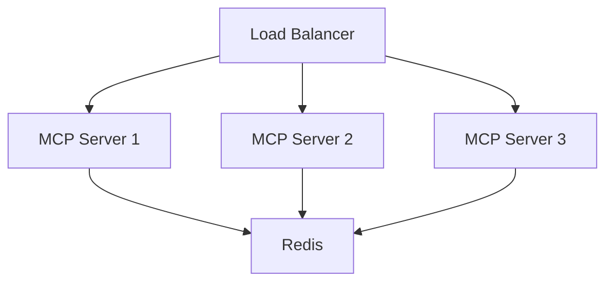

# Multi-MCP Server Container Deployment Guide

## System Overview
This containerized setup includes:
- 3 redundant MCP servers (Flash Loan, Price Feed, Arbitrage)
- Risk management server
- Monitoring stack (Prometheus/Grafana)
- Redis cluster for caching
- PostgreSQL for transaction logging
- GitHub Copilot integration for automated error fixing

## Prerequisites
- Docker 20.10+
- Docker Compose 2.0+
- GitHub Pro account with Copilot enabled
- Aave API credentials
- Ethereum node RPC endpoint

## Setup Instructions

### 1. Configuration
```bash
cp .env.example .env
# Fill in your GitHub token and API keys
nano .env
```

### 2. Build and Start Containers
```bash
chmod +x scripts/start_flashloan_system.sh
./scripts/start_flashloan_system.sh
```

### 3. Verify Services
Check container status:
```bash
docker ps -a
```

Access dashboards:
- Grafana: http://localhost:3000 (admin/admin123)
- Prometheus: http://localhost:9090

## Key Features

### GitHub Copilot Integration
- Real-time code suggestions
- Automated error fixing
- Syntax checking

### High Availability Architecture


### Monitoring Setup
- Performance metrics
- Error tracking
- Alert notifications

## Maintenance
- View logs: `docker-compose logs -f`
- Restart services: `docker-compose restart`
- Update containers: `docker-compose pull && docker-compose up -d`

## Troubleshooting
Common issues:
- GitHub auth: Ensure token has proper permissions
- Redis cluster: Check node connectivity
- Database: Verify PostgreSQL connection settings