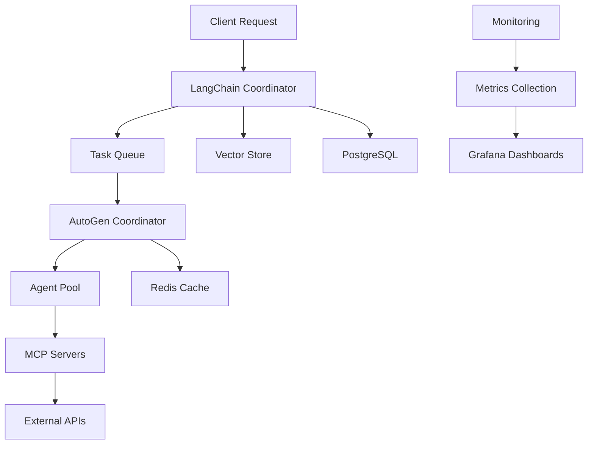

# LangChain-AutoGen-MCP Unified System Deployment Guide

## Table of Contents

1. [Overview](#overview)
2. [System Requirements](#system-requirements)
3. [Prerequisites](#prerequisites)
4. [Quick Start](#quick-start)
5. [Detailed Setup](#detailed-setup)
6. [Configuration](#configuration)
7. [Testing and Validation](#testing-and-validation)
8. [Monitoring and Maintenance](#monitoring-and-maintenance)
9. [Troubleshooting](#troubleshooting)
10. [API Usage Examples](#api-usage-examples)
11. [Integration Patterns](#integration-patterns)
12. [Performance Tuning](#performance-tuning)
13. [Security Considerations](#security-considerations)
14. [Backup and Recovery](#backup-and-recovery)

## Overview

The LangChain-AutoGen-MCP Unified System is a comprehensive AI-powered platform that combines:

- **LangChain**: Advanced language model orchestration and tool integration
- **AutoGen**: Multi-agent conversation and coordination framework
- **MCP (Model Context Protocol)**: Standardized context and memory management
- **Monitoring Stack**: Prometheus, Grafana, Elasticsearch, and Kibana
- **Database Layer**: PostgreSQL for persistence, Redis for caching
- **Message Queue**: RabbitMQ for async communication

### Architecture Overview

```
┌─────────────────┐    ┌─────────────────┐    ┌─────────────────┐
│  Web Dashboard  │    │   Grafana UI    │    │   Kibana UI     │
└─────────────────┘    └─────────────────┘    └─────────────────┘
         │                       │                       │
         └───────────────────────┼───────────────────────┘
                                 │
┌─────────────────────────────────────────────────────────────────┐
│                    Load Balancer / Reverse Proxy                │
└─────────────────────────────────────────────────────────────────┘
                                 │
         ┌───────────────────────┼───────────────────────┐
         │                       │                       │
┌─────────────────┐    ┌─────────────────┐    ┌─────────────────┐
│ LangChain       │    │ AutoGen         │    │ MCP Servers     │
│ Coordinator     │    │ Coordinator     │    │ Pool            │
│ (Port 8000)     │    │ (Port 8010)     │    │ (Ports 8100+)   │
└─────────────────┘    └─────────────────┘    └─────────────────┘
         │                       │                       │
         └───────────────────────┼───────────────────────┘
                                 │
┌─────────────────────────────────────────────────────────────────┐
│                     Message Bus (RabbitMQ)                     │
└─────────────────────────────────────────────────────────────────┘
                                 │
         ┌───────────────────────┼───────────────────────┐
         │                       │                       │
┌─────────────────┐    ┌─────────────────┐    ┌─────────────────┐
│ PostgreSQL      │    │ Redis Cache     │    │ Vector Store    │
│ Database        │    │                 │    │ (Chroma)        │
└─────────────────┘    └─────────────────┘    └─────────────────┘
```

## System Requirements

### Minimum Requirements

- **CPU**: 4 cores (x86_64)
- **RAM**: 8GB
- **Storage**: 50GB free space
- **Network**: Stable internet connection
- **OS**: Ubuntu 20.04+, Debian 11+, CentOS 8+, or macOS 12+

### Recommended Requirements

- **CPU**: 8+ cores (x86_64)
- **RAM**: 16GB+
- **Storage**: 100GB+ SSD
- **Network**: High-speed internet (100+ Mbps)
- **OS**: Ubuntu 22.04 LTS (preferred)

### Production Requirements

- **CPU**: 16+ cores
- **RAM**: 32GB+
- **Storage**: 500GB+ NVMe SSD
- **Network**: Dedicated bandwidth
- **Load Balancer**: External load balancer for high availability

## Prerequisites

### 1. Docker and Docker Compose

```bash
# Install Docker
curl -fsSL https://get.docker.com -o get-docker.sh
sudo sh get-docker.sh
sudo usermod -aG docker $USER

# Install Docker Compose
sudo curl -L "https://github.com/docker/compose/releases/download/v2.24.0/docker-compose-$(uname -s)-$(uname -m)" -o /usr/local/bin/docker-compose
sudo chmod +x /usr/local/bin/docker-compose

# Verify installations
docker --version
docker-compose --version
```

### 2. Git

```bash
# Ubuntu/Debian
sudo apt-get update && sudo apt-get install -y git

# CentOS/RHEL
sudo yum install -y git

# macOS
brew install git
```

### 3. Python 3.8+

```bash
# Ubuntu/Debian
sudo apt-get install -y python3 python3-pip

# CentOS/RHEL
sudo yum install -y python3 python3-pip

# macOS
brew install python3
```

### 4. Node.js 18+ (for MCP servers)

```bash
# Install using NodeSource repository
curl -fsSL https://deb.nodesource.com/setup_18.x | sudo -E bash -
sudo apt-get install -y nodejs

# Or using package manager
# Ubuntu/Debian: sudo apt-get install -y nodejs npm
# macOS: brew install node
```

## Quick Start

### 1. Clone the Repository

```bash
git clone <repository-url>
cd flash-loan-system
```

### 2. Setup Environment

```bash
# Copy environment template
cp .env.example .env

# Edit environment variables (REQUIRED)
nano .env
```

**Critical Environment Variables to Set:**

```bash
# API Keys (REQUIRED)
OPENAI_API_KEY=your_openai_api_key_here
ANTHROPIC_API_KEY=your_anthropic_api_key_here
GITHUB_TOKEN=your_github_token_here

# Database Passwords
POSTGRES_PASSWORD=your_secure_password_here
REDIS_PASSWORD=your_redis_password_here
RABBITMQ_PASSWORD=your_rabbitmq_password_here
```

### 3. Run System Check

```bash
# Make scripts executable
chmod +x deployment/docker/*.sh

# Run pre-deployment checks
./deployment/docker/troubleshoot.sh --auto-fix
```

### 4. Deploy the System

```bash
# Navigate to deployment directory
cd deployment/docker

# Start all services
docker-compose -f docker-compose.unified.yml up -d

# Monitor startup
docker-compose -f docker-compose.unified.yml logs -f
```

### 5. Verify Deployment

```bash
# Run comprehensive tests
./test-system.sh

# Check service health
curl http://localhost:8000/health
curl http://localhost:8010/health
```

## Detailed Setup

### Step 1: Repository Setup

```bash
# Clone the repository
git clone <repository-url>
cd flash-loan-system

# Verify project structure
ls -la
# Should see: deployment/, config/, src/, tests/, etc.
```

### Step 2: Environment Configuration

Create and configure the `.env` file:

```bash
# Copy the example file
cp .env.example .env
```

Edit `.env` with your specific configuration:

```bash
# =================================================================
# LangChain-AutoGen-MCP System Environment Configuration
# =================================================================

# API Keys (REQUIRED - Obtain from respective providers)
OPENAI_API_KEY=sk-your-openai-key-here
ANTHROPIC_API_KEY=your-anthropic-key-here
GOOGLE_API_KEY=your-google-api-key-here
GITHUB_TOKEN=ghp_your-github-token-here
GITHUB_COPILOT_API_KEY=your-copilot-key-here

# Database Configuration
POSTGRES_DB=flash_loan_db
POSTGRES_USER=flash_loan_user
POSTGRES_PASSWORD=SecurePassword123!
POSTGRES_PORT=5432

# Redis Configuration
REDIS_PASSWORD=RedisSecure456!
REDIS_PORT=6379

# RabbitMQ Configuration
RABBITMQ_USER=flash_loan_mq
RABBITMQ_PASSWORD=RabbitSecure789!
RABBITMQ_VHOST=flash_loan_vhost
RABBITMQ_PORT=5672
RABBITMQ_MANAGEMENT_PORT=15672

# MCP Server Configuration
SUPERMEMORY_API_KEY=your-supermemory-key-here

# System Configuration
LOG_LEVEL=INFO
ENABLE_METRICS=true
ENABLE_DEBUG=false

# Performance Tuning
MAX_CONCURRENT_TASKS=5
TASK_TIMEOUT=300
```

### Step 3: Network and Security Setup

```bash
# Create necessary directories
mkdir -p logs/{langchain,autogen,mcp,monitoring}
mkdir -p data/{postgres,redis,elasticsearch}
mkdir -p config/{prometheus,grafana,dashboards}

# Set proper permissions
chmod 755 logs/ data/ config/
chmod +x deployment/docker/*.sh
```

### Step 4: Pre-deployment Validation

```bash
# Run the troubleshooter
cd deployment/docker
./troubleshoot.sh --auto-fix --auto-start

# This will:
# - Check Docker installation
# - Validate required files
# - Test system resources
# - Check port availability
# - Fix common issues automatically
```

### Step 5: Service Deployment

```bash
# Deploy infrastructure services first
docker-compose -f docker-compose.unified.yml up -d postgres redis rabbitmq

# Wait for infrastructure to be ready
sleep 30

# Deploy MCP servers
docker-compose -f docker-compose.unified.yml up -d mcp-supermemory mcp-context7 mcp-filesystem mcp-taskmanager

# Wait for MCP servers
sleep 45

# Deploy coordinators
docker-compose -f docker-compose.unified.yml up -d langchain-coordinator autogen-coordinator

# Deploy monitoring and web interface
docker-compose -f docker-compose.unified.yml up -d

# Verify all services are running
docker-compose -f docker-compose.unified.yml ps
```

## Configuration

### LangChain Coordinator Configuration

Edit `deployment/docker/langchain/main.py` for custom agent configuration:

```python
# Custom agent configuration
AGENT_CONFIG = {
    "code_interpreter": {
        "enabled": True,
        "timeout": 30,
        "max_iterations": 5
    },
    "rag_agent": {
        "enabled": True,
        "vector_store": "chroma",
        "embedding_model": "text-embedding-ada-002"
    },
    "arbitrage_agent": {
        "enabled": True,
        "risk_threshold": 0.05,
        "max_position_size": 1000000
    }
}
```

### AutoGen Coordinator Configuration

Edit `deployment/docker/autogen/main.py` for agent settings:

```python
# AutoGen configuration
AUTOGEN_CONFIG = {
    "max_agents": 10,
    "conversation_timeout": 600,
    "max_rounds": 10,
    "temperature": 0.1
}
```

### MCP Server Configuration

Edit `config/unified_mcp_config.json`:

```json
{
  "servers": {
    "supermemory": {
      "enabled": true,
      "port": 8100,
      "memory_limit": "1GB",
      "retention_days": 30
    },
    "context7": {
      "enabled": true,
      "port": 8101,
      "cache_size": "500MB"
    },
    "filesystem": {
      "enabled": true,
      "port": 8102,
      "allowed_paths": ["/workspace", "/tmp"]
    }
  }
}
```

## Testing and Validation

### Comprehensive System Testing

```bash
# Run all tests
cd deployment/docker
./test-system.sh

# Run specific test categories
./test-system.sh --category endpoints
./test-system.sh --category integration
./test-system.sh --category performance
```

### Integration Validation

```bash
# Run integration validator
python3 validate-integration.py

# Run with specific options
python3 validate-integration.py --verbose --output results.json
```

### Manual Testing

```bash
# Test LangChain coordinator
curl -X POST http://localhost:8000/api/v1/coordinate \
  -H "Content-Type: application/json" \
  -d '{
    "task": "analyze_market_data",
    "parameters": {
      "symbol": "ETH/USDC",
      "timeframe": "1h"
    }
  }'

# Test AutoGen coordinator
curl -X POST http://localhost:8010/coordinate \
  -H "Content-Type: application/json" \
  -d '{
    "task": "multi_agent_analysis",
    "agents": ["analyzer", "risk_manager"],
    "data": {"market": "DeFi"}
  }'

# Test MCP servers
curl http://localhost:8100/health
curl http://localhost:8101/health
curl http://localhost:8102/health
```

## Monitoring and Maintenance

### Monitoring Dashboards

Access monitoring interfaces:

- **Grafana**: http://localhost:3000 (admin/admin)
- **Prometheus**: http://localhost:9090
- **Kibana**: http://localhost:5601
- **RabbitMQ Management**: http://localhost:15672
- **Web Dashboard**: http://localhost:8090

### Health Monitoring

```bash
# Check all service health
curl http://localhost:8000/health | jq
curl http://localhost:8010/health | jq

# Monitor resource usage
docker stats

# Check logs
docker-compose -f docker-compose.unified.yml logs --tail 100 -f
```

### Log Management

```bash
# Centralized logging locations
ls -la logs/
# - langchain/: LangChain coordinator logs
# - autogen/: AutoGen coordinator logs
# - mcp/: MCP server logs
# - monitoring/: System monitoring logs

# Rotate logs (add to crontab)
0 0 * * * find /path/to/logs -name "*.log" -mtime +7 -delete
```

### Backup Procedures

```bash
# Backup script example
#!/bin/bash
BACKUP_DATE=$(date +%Y%m%d_%H%M%S)
BACKUP_DIR="/backups/flashloan-system"

# Create backup directory
mkdir -p "$BACKUP_DIR"

# Backup PostgreSQL
docker exec flash-loan-postgres pg_dump -U flash_loan_user flash_loan_db > "$BACKUP_DIR/postgres_$BACKUP_DATE.sql"

# Backup Redis
docker exec flash-loan-redis redis-cli --rdb > "$BACKUP_DIR/redis_$BACKUP_DATE.rdb"

# Backup configurations
tar -czf "$BACKUP_DIR/config_$BACKUP_DATE.tar.gz" config/

echo "Backup completed: $BACKUP_DIR"
```

## Troubleshooting

### Common Issues and Solutions

#### 1. Services Won't Start

**Symptoms**: Containers exit immediately or fail to start

**Diagnosis**:
```bash
# Check container logs
docker logs flash-loan-langchain
docker logs flash-loan-autogen

# Run troubleshooter
./troubleshoot.sh --auto-fix
```

**Solutions**:
- Check port conflicts: `./troubleshoot.sh`
- Verify environment variables in `.env`
- Ensure sufficient system resources
- Check Docker daemon status

#### 2. API Key Issues

**Symptoms**: Authentication errors, API call failures

**Diagnosis**:
```bash
# Check environment variables
docker exec flash-loan-langchain env | grep API_KEY
```

**Solutions**:
- Verify API keys in `.env` file
- Ensure no spaces or special characters
- Check API key permissions and quotas

#### 3. Database Connection Issues

**Symptoms**: "Connection refused" errors, timeout errors

**Diagnosis**:
```bash
# Test PostgreSQL connection
docker exec flash-loan-postgres pg_isready -U flash_loan_user

# Test Redis connection
docker exec flash-loan-redis redis-cli ping
```

**Solutions**:
- Check database passwords in `.env`
- Verify container networking
- Check database initialization logs

#### 4. Memory Issues

**Symptoms**: Containers getting killed, slow performance

**Diagnosis**:
```bash
# Check memory usage
free -h
docker stats --no-stream
```

**Solutions**:
- Increase system memory
- Reduce concurrent tasks in configuration
- Enable swap if necessary

#### 5. Performance Issues

**Symptoms**: Slow API responses, high CPU usage

**Diagnosis**:
```bash
# Monitor system resources
htop
docker stats

# Check service metrics
curl http://localhost:8000/metrics
```

**Solutions**:
- Scale services horizontally
- Optimize model parameters
- Increase resource limits in Docker Compose

### Guided Troubleshooting

Run the interactive troubleshooter:

```bash
./troubleshoot.sh
```

This script will:
1. Check system prerequisites
2. Validate configuration files
3. Test service connectivity
4. Diagnose common issues
5. Suggest fixes
6. Generate detailed reports

### Debug Mode

Enable debug logging:

```bash
# Update .env file
ENABLE_DEBUG=true
LOG_LEVEL=DEBUG

# Restart services
docker-compose -f docker-compose.unified.yml restart
```

## API Usage Examples

### LangChain Coordinator API

#### Basic Task Execution

```python
import requests
import json

# Execute a code interpretation task
response = requests.post(
    "http://localhost:8000/api/v1/process",
    json={
        "task_type": "code_execution",
        "description": "Calculate fibonacci sequence up to 10",
        "context": {"language": "python"},
        "agent_type": "code_interpreter"
    }
)

result = response.json()
print(json.dumps(result, indent=2))
```

#### Multi-Agent Coordination

```python
# Coordinate multiple agents for complex task
response = requests.post(
    "http://localhost:8000/api/v1/coordinate",
    json={
        "scenario": "defi_analysis",
        "agents": ["rag_agent", "arbitrage_agent"],
        "task": "Analyze yield farming opportunities in Uniswap V3",
        "parameters": {
            "pools": ["ETH/USDC", "ETH/DAI"],
            "timeframe": "24h",
            "risk_tolerance": "medium"
        }
    }
)
```

#### RAG Agent Usage

```python
# Query knowledge base
response = requests.post(
    "http://localhost:8000/api/v1/rag/query",
    json={
        "query": "What are the latest developments in DeFi protocols?",
        "context_limit": 5,
        "include_sources": True
    }
)
```

### AutoGen Coordinator API

#### Multi-Agent Conversation

```python
# Start multi-agent discussion
response = requests.post(
    "http://localhost:8010/coordinate",
    json={
        "conversation_type": "group_chat",
        "participants": ["market_analyst", "risk_manager", "trader"],
        "topic": "Evaluate arbitrage opportunity between DEXes",
        "initial_message": "Please analyze the ETH/USDC price difference between Uniswap and SushiSwap",
        "max_rounds": 5
    }
)

conversation_id = response.json()["conversation_id"]

# Get conversation status
status_response = requests.get(f"http://localhost:8010/conversations/{conversation_id}")
```

#### Agent Management

```python
# List available agents
agents_response = requests.get("http://localhost:8010/agents")
print(agents_response.json())

# Get agent details
agent_response = requests.get("http://localhost:8010/agents/market_analyst")
```

### MCP Server Integration

#### SuperMemory Usage

```python
# Store memory
memory_response = requests.post(
    "http://localhost:8100/api/memories",
    json={
        "content": "Uniswap V3 introduces concentrated liquidity",
        "tags": ["defi", "uniswap", "liquidity"],
        "metadata": {"source": "documentation", "timestamp": "2024-01-01"}
    }
)

# Search memories
search_response = requests.get(
    "http://localhost:8100/api/memories/search",
    params={"query": "concentrated liquidity", "limit": 5}
)
```

#### Context7 Integration

```python
# Get library documentation
docs_response = requests.get(
    "http://localhost:8101/api/docs",
    params={"library": "web3.py", "version": "latest"}
)
```

#### Filesystem Operations

```python
# List directory contents
files_response = requests.get(
    "http://localhost:8102/api/files",
    params={"path": "/workspace", "recursive": False}
)

# Read file content
file_content = requests.get(
    "http://localhost:8102/api/files/read",
    params={"path": "/workspace/config.json"}
)
```

## Integration Patterns

### Event-Driven Architecture

The system uses RabbitMQ for asynchronous communication:

```python
import pika
import json

# Connect to RabbitMQ
connection = pika.BlockingConnection(
    pika.ConnectionParameters('localhost', 5672, 'flash_loan_vhost', 
                            pika.PlainCredentials('flash_loan_mq', 'your_password'))
)
channel = connection.channel()

# Publish task to queue
channel.basic_publish(
    exchange='tasks',
    routing_key='langchain.coordinate',
    body=json.dumps({
        "task_id": "unique_task_id",
        "task_type": "arbitrage_analysis",
        "parameters": {"pair": "ETH/USDC"}
    })
)
```

### Microservices Communication

Services communicate via REST APIs and message queues:

```yaml
# Service communication pattern
LangChain Coordinator:
  - Receives tasks via REST API
  - Publishes events to RabbitMQ
  - Queries MCP servers for context
  - Stores results in PostgreSQL

AutoGen Coordinator:
  - Subscribes to RabbitMQ events
  - Manages multi-agent conversations
  - Publishes conversation results
  - Caches state in Redis

MCP Servers:
  - Provide specialized services
  - Maintain independent state
  - Expose REST APIs
  - Handle concurrent requests
```

### Data Flow Architecture



## Performance Tuning

### Resource Optimization

#### Memory Optimization

```yaml
# Docker Compose memory limits
services:
  langchain-coordinator:
    deploy:
      resources:
        limits:
          memory: 2G
        reservations:
          memory: 1G

  autogen-coordinator:
    deploy:
      resources:
        limits:
          memory: 2G
        reservations:
          memory: 1G
```

#### CPU Optimization

```bash
# Set CPU affinity for containers
docker update --cpuset-cpus="0,1" flash-loan-langchain
docker update --cpuset-cpus="2,3" flash-loan-autogen
```

### Database Tuning

#### PostgreSQL Configuration

```sql
-- Optimize PostgreSQL settings
ALTER SYSTEM SET shared_buffers = '256MB';
ALTER SYSTEM SET effective_cache_size = '1GB';
ALTER SYSTEM SET work_mem = '16MB';
ALTER SYSTEM SET maintenance_work_mem = '64MB';
ALTER SYSTEM SET checkpoint_completion_target = 0.9;
ALTER SYSTEM SET wal_buffers = '16MB';
SELECT pg_reload_conf();
```

#### Redis Configuration

```bash
# Redis optimization in redis.conf
maxmemory 512mb
maxmemory-policy allkeys-lru
save 900 1
save 300 10
save 60 10000
```

### Application-Level Tuning

#### Concurrent Task Limits

```bash
# Update .env for optimal concurrency
MAX_CONCURRENT_TASKS=10
TASK_TIMEOUT=180
WORKER_PROCESSES=4
```

#### Model Configuration

```python
# Optimize model parameters
LLM_CONFIG = {
    "temperature": 0.1,
    "max_tokens": 2048,
    "top_p": 0.9,
    "frequency_penalty": 0.1,
    "presence_penalty": 0.1
}
```

## Security Considerations

### Environment Security

```bash
# Secure .env file permissions
chmod 600 .env
chown root:root .env

# Use Docker secrets for production
echo "your_secret_password" | docker secret create postgres_password -
```

### Network Security

```yaml
# Docker Compose network isolation
networks:
  flash-loan-network:
    driver: bridge
    internal: true  # Isolate internal traffic
    ipam:
      config:
        - subnet: 172.20.0.0/16
```

### API Security

```python
# Implement API authentication
from fastapi import HTTPException, Depends
from fastapi.security import HTTPBearer

security = HTTPBearer()

async def verify_token(token: str = Depends(security)):
    if not verify_api_token(token.credentials):
        raise HTTPException(status_code=401, detail="Invalid token")
    return token
```

### Data Encryption

```bash
# Enable encryption at rest for PostgreSQL
initdb --pwfile=password.txt --auth-local=md5 --auth-host=md5 -E UTF8 -D /var/lib/postgresql/data
```

## Backup and Recovery

### Automated Backup Script

```bash
#!/bin/bash
# backup.sh - Automated backup script

set -euo pipefail

BACKUP_DIR="/backups/flashloan-$(date +%Y%m%d_%H%M%S)"
mkdir -p "$BACKUP_DIR"

# Backup PostgreSQL
docker exec flash-loan-postgres pg_dump -U flash_loan_user -f /tmp/backup.sql flash_loan_db
docker cp flash-loan-postgres:/tmp/backup.sql "$BACKUP_DIR/postgres.sql"

# Backup Redis
docker exec flash-loan-redis redis-cli --rdb > "$BACKUP_DIR/redis.rdb"

# Backup configurations
tar -czf "$BACKUP_DIR/configs.tar.gz" config/ .env

# Backup vector store
tar -czf "$BACKUP_DIR/vector_store.tar.gz" data/vector_store/

# Upload to S3 (optional)
aws s3 cp "$BACKUP_DIR" s3://your-backup-bucket/flashloan/ --recursive

echo "Backup completed: $BACKUP_DIR"
```

### Recovery Procedures

```bash
#!/bin/bash
# restore.sh - Recovery script

BACKUP_DIR="$1"

if [[ -z "$BACKUP_DIR" ]]; then
    echo "Usage: $0 <backup_directory>"
    exit 1
fi

# Stop services
docker-compose -f docker-compose.unified.yml down

# Restore PostgreSQL
docker-compose -f docker-compose.unified.yml up -d postgres
sleep 30
docker cp "$BACKUP_DIR/postgres.sql" flash-loan-postgres:/tmp/
docker exec flash-loan-postgres psql -U flash_loan_user -d flash_loan_db -f /tmp/postgres.sql

# Restore Redis
docker-compose -f docker-compose.unified.yml up -d redis
sleep 10
docker cp "$BACKUP_DIR/redis.rdb" flash-loan-redis:/tmp/
docker exec flash-loan-redis redis-cli -p 6379 --rdb /tmp/redis.rdb

# Restore configurations
tar -xzf "$BACKUP_DIR/configs.tar.gz"

# Start all services
docker-compose -f docker-compose.unified.yml up -d

echo "Recovery completed from: $BACKUP_DIR"
```

---

## Support and Contributing

### Getting Help

1. Check this deployment guide
2. Run the troubleshooter: `./troubleshoot.sh`
3. Review logs in `logs/` directory
4. Check GitHub issues
5. Join our Discord community

### Contributing

1. Fork the repository
2. Create feature branch
3. Submit pull request
4. Follow coding standards
5. Include tests

### License

This project is licensed under the MIT License. See LICENSE file for details.

---

**Last Updated**: December 2024
**Version**: 1.0.0
**Compatibility**: Docker 20.10+, Docker Compose 2.0+