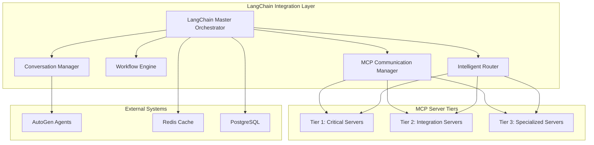

# LangChain Master Orchestrator

A comprehensive LangChain integration system for flash loan arbitrage operations, providing intelligent workflow orchestration, MCP server communication, and multi-agent decision-making capabilities.

## Overview

The LangChain Master Orchestrator is the central coordination layer for the flash loan arbitrage system, implementing the architectural plan outlined in [`Flash_Loan_LangChain_AutoGen_MCP_Integration_Plan.md`](../../Flash_Loan_LangChain_AutoGen_MCP_Integration_Plan.md). It provides:

- **Workflow Orchestration**: Complex multi-step arbitrage strategies with dependency management
- **MCP Server Communication**: Intelligent load balancing across 24+ MCP servers
- **Multi-Agent Conversations**: Integration with AutoGen for consensus-based decision making
- **Intelligent Routing**: Performance-based server selection with circuit breaker patterns
- **State Management**: Persistent state across workflow executions
- **Monitoring & Observability**: Comprehensive metrics and health monitoring

## Architecture

The system follows a microservices architecture with the following core components:

### Core Components

1. **[`LangChainMasterOrchestrator`](langchain_master_orchestrator.py)** - Main coordination layer
2. **[`MCPCommunicationManager`](mcp_communication_manager.py)** - MCP server interface management
3. **[`WorkflowEngine`](workflow_engine.py)** - Multi-step workflow execution engine
4. **[`IntelligentRouter`](intelligent_router.py)** - Load balancing and server selection
5. **[`ConversationManager`](conversation_manager.py)** - Multi-agent conversation handling

### System Integration



## Quick Start

### Prerequisites

- Python 3.8+
- Redis server
- PostgreSQL (optional)
- AutoGen service running on port 8001
- MCP servers configured and running

### Installation

1. **Install dependencies:**

    ```bash
    pip install -r requirements.txt
    ```

2. **Configure the system:**

    ```bash
    # Copy and edit configuration
    cp config/langchain_config.yaml.example config/langchain_config.yaml
    ```

3. **Set environment variables:**

    ```bash
    export REDIS_URL="redis://localhost:6379"
    export OPENAI_API_KEY="your_openai_api_key"
    export AUTOGEN_URL="http://localhost:8001"
    ```

4. **Start the system:**

    ```bash
    python main.py
    ```

### Basic Usage

```python
from langchain_master_orchestrator import LangChainMasterOrchestrator

# Initialize orchestrator
config = {...}  # Load from config file
orchestrator = LangChainMasterOrchestrator(config)
await orchestrator.initialize()

# Execute arbitrage workflow
opportunity = {
    "token_pair": "ETH/USDC",
    "dex_a": "uniswap",
    "dex_b": "sushiswap",
    "price_difference": 0.5,
    "amount": 10000
}

result = await orchestrator.execute_arbitrage_workflow(opportunity)
print(f"Execution result: {result}")
```

## Configuration

The system is configured through [`config/langchain_config.yaml`](../../config/langchain_config.yaml):

### Key Configuration Sections

- **`system`**: Basic system settings
- **`mcp_servers`**: MCP server tier configuration
- **`autogen`**: AutoGen integration settings
- **`routing`**: Load balancing and routing rules
- **`workflow`**: Workflow execution parameters
- **`conversation`**: Multi-agent conversation settings
- **`monitoring`**: Metrics and alerting configuration

### Environment Variables

| Variable | Description | Default |
|----------|-------------|---------|
| `REDIS_URL` | Redis connection URL | `redis://localhost:6379` |
| `POSTGRES_PASSWORD` | PostgreSQL password | - |
| `OPENAI_API_KEY` | OpenAI API key for AutoGen | - |
| `AUTOGEN_URL` | AutoGen service URL | `http://localhost:8001` |
| `LOG_LEVEL` | Logging level | `INFO` |

## Workflows

The system includes three main workflow types:

### 1. Arbitrage Analysis Workflow

**Purpose**: Analyze arbitrage opportunities across DEXes

**Steps**:

1. `fetch_market_data` - Retrieve current market data
2. `calculate_arbitrage` - Calculate profit potential
3. `validate_liquidity` - Check liquidity availability
4. `assess_gas_costs` - Calculate transaction costs

**Timeout**: 120 seconds

### 2. Risk Assessment Workflow

**Purpose**: Comprehensive risk evaluation

**Steps**:

1. `analyze_price_volatility` - Assess market stability
2. `check_slippage_risk` - Calculate slippage impact
3. `validate_smart_contracts` - Security verification
4. `calculate_risk_score` - Overall risk scoring

**Timeout**: 90 seconds

### 3. Trade Execution Workflow

**Purpose**: Execute flash loan arbitrage trades

**Steps**:

1. `prepare_flash_loan` - Setup loan parameters
2. `execute_flash_loan` - Execute the transaction
3. `monitor_transaction` - Track completion
4. `calculate_profit` - Determine actual profit

**Timeout**: 300 seconds

## MCP Server Integration

The system integrates with 24+ MCP servers across three tiers:

### Tier 1 - Critical Servers (Always Active)

- **Filesystem** (port 3023): File operations and configuration
- **Context7** (port 3022): Documentation and code examples
- **Supermemory** (port 3021): State persistence and memory
- **Taskmanager** (port 3020): Task orchestration

### Tier 2 - Integration Services (Load Balanced)

- **LangChain Orchestrator** (port 3016): Workflow coordination
- **Enhanced Manager** (port 3015): System health management
- **Complete LangChain Integration** (port 3014): Integration services

### Tier 3 - Specialized Services (Demand-Based)

- **AAVE Flash Loan** (port 3001): Flash loan execution
- **Arbitrage Detector** (port 3003): Opportunity detection
- **Risk Analyzer** (port 3007): Risk assessment

## Multi-Agent Conversations

Integration with AutoGen enables sophisticated multi-agent decision-making:

### Conversation Types

1. **Arbitrage Decision**: Coordinate arbitrage execution decisions
2. **Risk Assessment**: Multi-perspective risk evaluation
3. **Strategy Planning**: Long-term strategy development
4. **Execution Approval**: Final execution authorization

### Decision Algorithms

- **Majority Consensus**: Simple majority voting
- **Weighted Consensus**: Expertise-based weighting
- **Unanimous Consensus**: Require full agreement
- **Risk Weighted Decision**: Risk-adjusted decision making

## Monitoring and Observability

### Key Metrics

- **Performance**: Response times, throughput, success rates
- **Health**: Server health scores, circuit breaker status
- **Business**: Profit per trade, execution success rate
- **System**: Memory usage, connection counts, queue depth

### Alerts

- **Critical**: Server down, high error rate, failed arbitrage
- **Warning**: Slow response, moderate latency, memory usage
- **Info**: Circuit breaker changes, configuration updates

### Health Endpoints

- `GET /health` - Basic health check
- `GET /status` - Detailed system status
- `GET /metrics` - Prometheus-compatible metrics

## Development

### Running Tests

```bash
# Install test dependencies
pip install -r requirements.txt

# Run tests
pytest tests/

# Run with coverage
pytest --cov=src/langchain_integration tests/
```

### Code Quality

```bash
# Format code
black src/langchain_integration/

# Lint code
flake8 src/langchain_integration/

# Type checking
mypy src/langchain_integration/
```

### Adding New Workflows

1. **Define workflow steps** in `workflow_engine.py`
2. **Implement step handlers** for each workflow step
3. **Add workflow definition** to default workflows
4. **Update configuration** in `langchain_config.yaml`
5. **Add tests** for the new workflow

### Adding New MCP Servers

1. **Update server configuration** in `langchain_config.yaml`
2. **Add server capabilities** to the intelligent router
3. **Implement communication handlers** if needed
4. **Update health monitoring** configuration
5. **Add integration tests**

## Production Deployment

### Docker Deployment

```dockerfile
FROM python:3.11-slim

WORKDIR /app
COPY requirements.txt .
RUN pip install -r requirements.txt

COPY src/langchain_integration/ ./src/langchain_integration/
COPY config/ ./config/

CMD ["python", "src/langchain_integration/main.py"]
```

### Kubernetes Deployment

```yaml
apiVersion: apps/v1
kind: Deployment
metadata:
  name: langchain-orchestrator
spec:
  replicas: 3
  selector:
    matchLabels:
      app: langchain-orchestrator
  template:
    metadata:
      labels:
        app: langchain-orchestrator
    spec:
      containers:
      - name: orchestrator
        image: flash-loan/langchain-orchestrator:latest
        ports:
        - containerPort: 8000
        env:
        - name: REDIS_URL
          value: "redis://redis-service:6379"
        - name: POSTGRES_PASSWORD
          valueFrom:
            secretKeyRef:
              name: postgres-secret
              key: password
```

### Environment-Specific Configuration

- **Development**: Debug logging, mock services, reduced timeouts
- **Staging**: Production-like setup with test data
- **Production**: Security hardening, monitoring, backup procedures

## Troubleshooting

### Common Issues

1. **MCP Server Connection Failures**
   - Check server health endpoints
   - Verify network connectivity
   - Review circuit breaker status

2. **AutoGen Integration Problems**
   - Verify AutoGen service is running
   - Check API endpoint configuration
   - Review conversation timeout settings

3. **Performance Issues**
   - Monitor server response times
   - Check Redis connection pool
   - Review load balancing metrics

4. **Memory Issues**
   - Monitor conversation history size
   - Check workflow execution cleanup
   - Review cache expiration settings

### Debug Mode

Enable debug mode for detailed logging:

```bash
export DEBUG=true
export LOG_LEVEL=DEBUG
python main.py
```

### Health Checks

Monitor system health through various endpoints:

```bash
# Basic health
curl http://localhost:8000/health

# Detailed status
curl http://localhost:8000/status

# Component health
curl http://localhost:8000/components/health
```

## Contributing

1. Fork the repository
2. Create a feature branch
3. Make changes with tests
4. Ensure code quality checks pass
5. Submit a pull request

## License

This project is part of the Flash Loan Arbitrage System. See the main project license for details.

## Support

For issues and questions:

1. Check the troubleshooting section
2. Review system logs
3. Check component health status
4. Consult the architectural documentation

---

**Note**: This implementation follows the architectural specifications in [`Flash_Loan_LangChain_AutoGen_MCP_Integration_Plan.md`](../../Flash_Loan_LangChain_AutoGen_MCP_Integration_Plan.md). The system is designed for high-availability production use with comprehensive monitoring and fault tolerance.